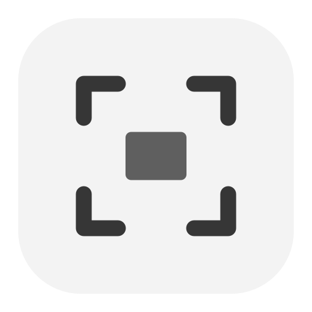

<p align="center">
  
</p>
<h1 align="center">Snap</h1>
<p align="center">A small screenshot app for macOS.</p>
<p align="center">
  
  
  
</p>

Snap holds the screen still when you start a capture. Drag an area, select a section within an app, select a whole window or capture a full display. The screen stays at its normal brightness. Each mode uses the same frozen image, so small details stay in place.

## Capture

Press **⌘⇧S** to start. Use **← / →** to move between four modes:

- **Select:** drag an area and release to capture it.
- **Region:** point to a detected rectangular section within an app and click. The smallest section under the pointer is highlighted. If no section is detected, it selects the window; use Select for an exact custom area.
- **App:** point to an app window and click to capture its visible area on the current display.
- **Full Screen:** click to capture the current display.

Snap copies the image to the clipboard. File saving starts **off for each capture**. Press **↑** to turn it on or off. The checkbox in the bottom bar shows the state. When saving is on, Snap writes a PNG to Desktop or your chosen folder.

| Key | Action |
| --- | --- |
| ⌘⇧S | Start a capture |
| ← / → | Change mode |
| ↑ | Turn file saving on or off |
| 1 / 2 / 3 / 4 | Select / Region / App / Full Screen |
| Return | Capture a region, app window or full display |
| Tab / Shift-Tab | Select the next / previous target in Region or App mode |
| Esc | Cancel |

## Settings

Click the Snap icon in the menu bar. The compact popup lets you start a capture, change the save folder, check screen access or quit. Right-click the icon for quick actions.

## Install from source

Use macOS 14 or later and a full Xcode installation with Swift 6.

```sh
git clone https://github.com/Upsidedly/snap.git
cd snap
./scripts/install.sh
open /Applications/Snap.app
```

Allow Screen Recording when macOS asks. You can change access in **System Settings → Privacy & Security**.

Quit Snap before installing an update. The script builds and signs the app locally and keeps a backup of an earlier installation. The first build creates a signing key in your login Keychain, then reuses it so screen access survives rebuilds. Updating from an older ad hoc build needs one final Screen Recording approval. There is no notarized download yet.

## Privacy

Snap does not use the network, record audio or upload images. It needs no account. Images stay in your clipboard and, when you turn on saving, in your chosen folder.

## Development

Build with `./scripts/build.sh`. Run the tests with:

```sh
DEVELOPER_DIR=/Applications/Xcode.app/Contents/Developer swift test
```

See [development notes](docs/DEVELOPMENT.md) for the app structure and test limits.
